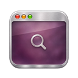
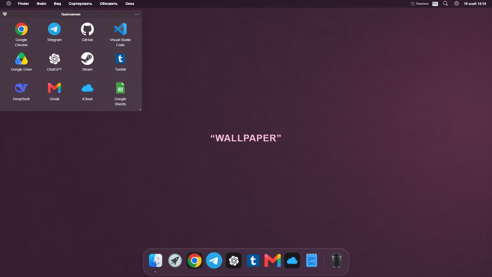

# CashTab

<p align="center"></p>

<p align="center"><strong>Your little desktop, in every new tab.</strong><br>A classic Mac-inspired Chrome new tab with a dock, notes and custom wallpapers. Local storage, no account, no subscription.</p>

<p align="center"><a href="https://github.com/r3in04ka-prog/CashTab/releases/latest/download/CashTab-v1.zip"><strong>Скачать CashTab / Download</strong></a> · <a href="https://github.com/r3in04ka-prog/CashTab/releases">Все версии / Releases</a></p>



Личное расширение Chrome: новая вкладка в стиле настольного Mac. Сливовые обои, верхнее меню, стеклянное окно приложений и док с увеличением иконок при наведении.

Пока распространяется через GitHub, без публикации в Chrome Web Store. Для установки потребуется режим разработчика. Загружайте готовый архив по ссылке выше: архив **Source code** содержит исходники для разработки.

## Установка — без команд и Node.js

1. Откройте в Chrome `chrome://extensions`.
2. Включите **Режим разработчика** справа сверху.
3. Нажмите **Загрузить распакованное расширение**.
4. Выберите папку **extension** внутри этого проекта, где лежит `manifest.json`.
5. Откройте новую вкладку и подтвердите использование CashTab, если Chrome спросит.

Если используете `CashTab-v1.zip`, сначала распакуйте его в постоянную папку и выберите её. Не удаляйте папку после установки. Предыдущее расширение новой вкладки может перехватывать экран: при необходимости отключите только его. Кнопка «Обновить» на карточке расширения в `chrome://extensions` загружает изменения manifest и ассетов.

Регистрация, сборка, сервер и права администратора для установленного расширения не нужны. В инкогнито Chrome не разрешает расширениям заменять новую вкладку.

### Quick installation (English)

Download the release ZIP using the link above and extract it to a permanent folder. Open `chrome://extensions`, enable **Developer mode**, click **Load unpacked**, and select the extracted folder containing `manifest.json`. Open a new tab. Keep the extracted folder on your computer. To update, replace its contents with the new release and click **Reload** on the extension card. CashTab is not yet listed in the Chrome Web Store.

## Что работает

- Клик по иконке открывает сайт в отдельной вкладке. Это веб-ссылки, а не запуск программ Windows.
- **Finder** показывает окно приложений; окно можно перетаскивать за заголовок и менять размер. Меню **Окна → Вернуть окна на место** сбрасывает расположение.
- **Файл → Добавить приложение**: название, URL, иконка и закрепление в доке. Максимум 100 ссылок, из них до 8 в доке. Порядок меняется стрелками в настройках.
- Сердечко в окне фильтрует приложения по избранным в доке.
- Удалённые ссылки попадают в восстанавливаемую **корзину ссылок**. Файлы компьютера не затрагиваются. Корзина хранит последние 100 ссылок.
- **Поиск** в меню или доке, а также `Alt+Space`: поиск Google или переход по адресу. Операционная система может перехватывать сочетание; кнопка работает независимо от него.
- **Заметки** в доке: локальный блокнот с автосохранением.
- **Настройки → Рабочий стол**: собственное изображение PNG/JPEG/WebP до 4 МБ, подпись на обоях, размер дока, 12/24-часовой формат и видимость окна.
- Настройки, позиции окон и заметки сохраняются при открытии новой вкладки. Размер изменённого окна сохраняется только на время текущей вкладки.
- Время берётся из часового пояса компьютера. Батарея, Wi-Fi и другая системная телеметрия не имитируются.

## Приватность

Расширение не запрашивает разрешений и не имеет content scripts или фонового service worker. Не читает историю, закладки, другие вкладки или файлы компьютера. При загрузке экрана не делает сетевых запросов: все шрифты системные, все иконки и обои встроены.

Настройки и заметки находятся в `localStorage`, обои — в локальной IndexedDB расширения. При удалении расширения или очистке его данных браузер может удалить настройки. Экспорт настроек в JSON не включает заметки и изображение обоев. Поиск отправляет введённый запрос Google только после нажатия Enter. При переходе по ссылке открывается выбранный сайт. При нажатии ссылок атрибуции открываются внешние сайты.

Встроенные примеры не переносят данные с показанного на скриншоте рабочего стола. Флаг и питомец из системного оверлея не входят в расширение.

## Разработка

```text
npm install
npm test
npm run dev
npm run package
```

Предпросмотр по умолчанию: `http://127.0.0.1:4173`. Иной порт: `npm run dev -- --port 4174`. Предпросмотр и расширение имеют разные локальные хранилища. Установка в реальный Chrome проверяется отдельно от веб-предпросмотра.

`npm run assets` восстанавливает SVG из установленных Iconify-пакетов; `node scripts/download-assets.mjs` скачивает сторонние PNG. Уже встроенные файлы позволяют пользоваться расширением офлайн без этих команд.

Тесты проверяют URL, запрет исполняемых схем, обработку повреждённых настроек, повторяющихся ID, предел дока, перестановку ссылок, manifest и наличие ассетов.

Исходный код — MIT. Иконки, логотипы и изображения имеют отдельные условия: см. `extension/ASSETS.md`.
